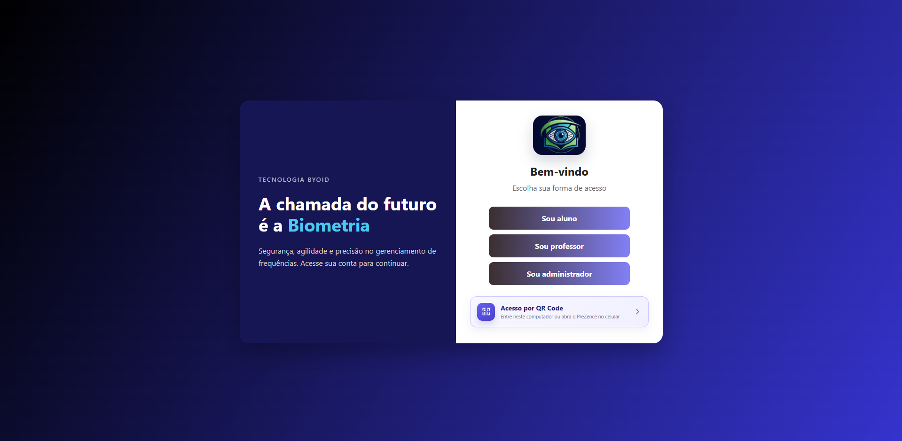

# PreZence | Controle Inteligente de Frequência Escolar

<p align="center">
  
</p>

<p align="center">
  <strong>A chamada do futuro é a Biometria.</strong><br>
  Uma solução inteligente para automatizar o controle de frequência escolar.
</p>

<p align="center">
  
  
  
</p>

---

## Índice

- [Sobre o Projeto](#-sobre-o-projeto)
- [Problema e Objetivo](#-problema-e-objetivo)
- [Funcionalidades](#-funcionalidades)
- [Como Funciona](#-como-funciona)
- [Demonstração do Sistema](#-demonstração-do-sistema)
- [Tecnologias Utilizadas](#-tecnologias-utilizadas)
- [Instalação e Execução](#-instalação-e-execução)
- [Equipe de Desenvolvimento](#-equipe-de-desenvolvimento)

---

## Sobre o Projeto

O **PreZence** é um sistema de gerenciamento de frequência escolar desenvolvido para otimizar o processo de registro de presença em instituições de ensino.

Por meio da tecnologia **ByoID**, baseada em reconhecimento facial, integração com geolocalização e métodos alternativos de identificação, o sistema busca tornar as chamadas mais ágeis, organizadas e confiáveis.

A plataforma oferece diferentes ambientes de acesso para alunos, professores e gestores, permitindo o acompanhamento das frequências, a administração das chamadas e a geração de relatórios.

O PreZence foi idealizado como um projeto de Trabalho de Conclusão de Curso (TCC) em Desenvolvimento de Sistemas, pela equipe ByID.

## Problema e Objetivo

A realização de chamadas tradicionais pode consumir parte significativa do tempo de aula, além de estar sujeita a inconsistências nos registros e dificuldades operacionais.

O PreZence surge como uma alternativa para modernizar esse processo, centralizando o controle de frequência em uma plataforma digital.

**Objetivos principais:**

- Automatizar o registro de presença dos estudantes.
- Reduzir o tempo dedicado às chamadas.
- Oferecer diferentes métodos de identificação.
- Facilitar o acompanhamento de faltas e frequências.
- Disponibilizar informações organizadas para professores e gestores.

## Funcionalidades

### Reconhecimento Facial

Utilização da tecnologia ByoID para identificar estudantes por meio de reconhecimento facial, oferecendo uma alternativa automatizada ao registro convencional de presença.

### Geolocalização (Geofencing)

Validação da localização do estudante, verificando se a solicitação de presença está sendo realizada dentro da área delimitada pela instituição de ensino.

### Métodos Alternativos de Chamada

O sistema disponibiliza alternativas para situações em que o reconhecimento facial ou o dispositivo do estudante não podem ser utilizados:

- Registro por códigos e tokens temporários.
- Solicitação de presença por métodos alternativos.
- Realização de chamadas manuais pelo professor.

### Gerenciamento de Chamadas

Os professores podem acompanhar as solicitações de presença, verificar os registros, realizar ajustes e finalizar as chamadas.

### Relatórios Inteligentes

Integração com inteligência artificial para auxiliar na elaboração de relatórios de frequência, considerando os registros de presença, ausência e justificativas dos estudantes.

Os relatórios são destinados aos professores, que podem revisar e editar o conteúdo antes de utilizá-lo ou compartilhá-lo.

### Ambientes de Acesso

A plataforma possui interfaces específicas para:

- **Alunos:** participação nas chamadas, consulta de faltas e avisos.
- **Professores:** gerenciamento de chamadas, acompanhamento das turmas e relatórios.
- **Gestores:** gerenciamento de usuários, turmas, frequências e informações administrativas.

---

## Como Funciona

O processo de registro de frequência envolve identificação, validação e confirmação.

<p align="center">
  
</p>

**Fluxo geral:**

1. O estudante solicita o registro de presença por um dos métodos disponíveis.
2. O sistema realiza as verificações de identificação e localização aplicáveis ao método utilizado.
3. A solicitação fica disponível para acompanhamento do professor.
4. O docente verifica e valida os registros, podendo realizar correções.
5. Após a validação, a chamada é finalizada e a frequência é registrada.

Esse processo permite combinar automação e supervisão docente, mantendo o professor responsável pela validação final da chamada.

---

## Demonstração do Sistema

A seguir, algumas das principais interfaces do PreZence.

### Tela Inicial

<p align="center">
  
</p>

### Área do Aluno

<p align="center">
  
</p>

### Área do Professor

<p align="center">
  
</p>

### Área do Gestor

<p align="center">
  
</p>

---

## Tecnologias Utilizadas

As tecnologias e ferramentas utilizadas no desenvolvimento do PreZence incluem:

| Tecnologia | Aplicação |
|:---:|---|
| Java | Desenvolvimento do Back-End |
| Spring Boot | Estruturação da aplicação e APIs |
| MySQL | Gerenciamento do banco de dados |
| HTML5 | Estruturação das interfaces |
| CSS3 | Estilização e responsividade |
| JavaScript | Funcionalidades e interatividade |
| ByoID | Tecnologia autoral de reconhecimento facial |
| Gemini API | Apoio à geração de relatórios inteligentes |

---

## Instalação e Execução

O PreZence foi desenvolvido para execução em ambiente local.

### Pré-requisitos

- Java e JDK compatíveis com a versão utilizada no projeto.
- IntelliJ IDEA ou ambiente de desenvolvimento Java equivalente.
- MySQL Server.
- Visual Studio Code ou editor equivalente.
- Navegador atualizado.
- Credenciais e configurações das APIs externas utilizadas.

### 1. Clonar o repositório

```bash
git clone URL_DO_REPOSITORIO
```

### 2. Configurar o banco de dados

Inicie o MySQL e crie o banco de dados conforme o nome definido na configuração do Back-End.

Configure as credenciais de acesso no arquivo `application.properties`.

### 3. Executar o Back-End

Abra o projeto no IntelliJ IDEA, verifique as dependências do Maven e execute a classe principal da aplicação Spring Boot.

### 4. Executar o Front-End

Abra os arquivos do Front-End no Visual Studio Code e execute a aplicação utilizando o servidor local configurado para o projeto.

### 5. Acessar o sistema

Com o Back-End e o Front-End em execução, acesse o endereço local configurado para a aplicação no navegador.

> **Observação:** as configurações de conexão com o banco de dados e as APIs externas devem ser ajustadas conforme o ambiente de execução.

---

## Equipe de Desenvolvimento

O PreZence foi desenvolvido pela equipe **ByID**, formada por estudantes do curso técnico em Desenvolvimento de Sistemas.

| Integrante | Responsabilidade | Especialidade |
|:---|:---|:---|
| **Lexander Bonfim** | Líder de Projeto, Front-End e Design | Gestão e estratégia |
| **Adrielly da Silva** | Front-End, Design e Análise | Requisitos e UI/UX |
| **Jhon Santos** | Back-End, Front-End e Design | Interface e experiência |
| **Kevyn Leal** | Desenvolvedor Full-Stack | Arquitetura de sistemas e APIs |

---

<p align="center">
  
</p>

<h3 align="center">PreZence</h3>

<p align="center">
  <strong>A chamada do futuro é a Biometria.</strong><br>
  Transformando a maneira de acompanhar a frequência escolar.
</p>

<p align="center">
  Desenvolvido pela equipe ByID · 2026
</p>
