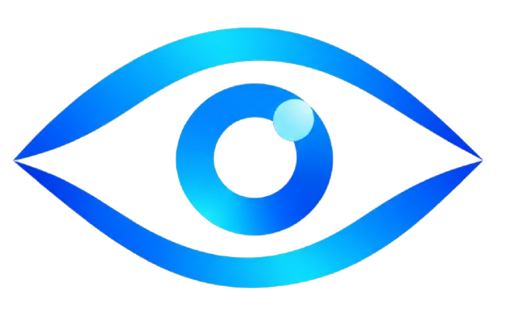
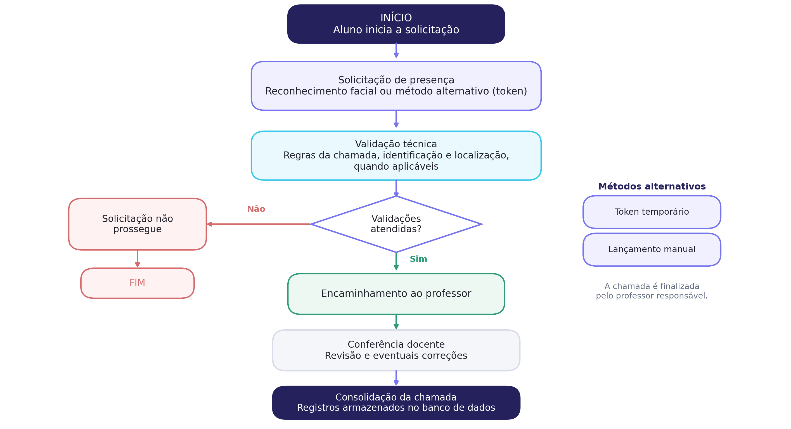
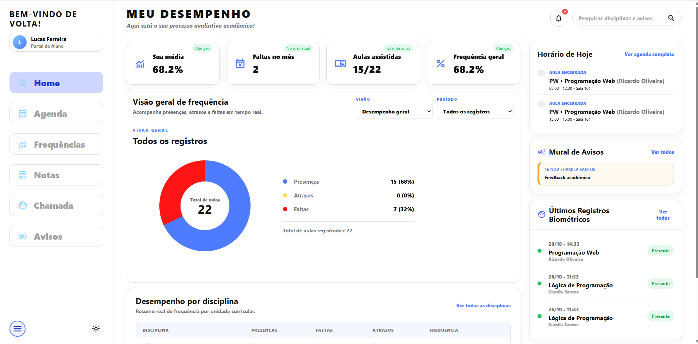
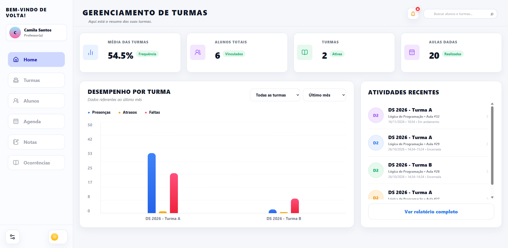
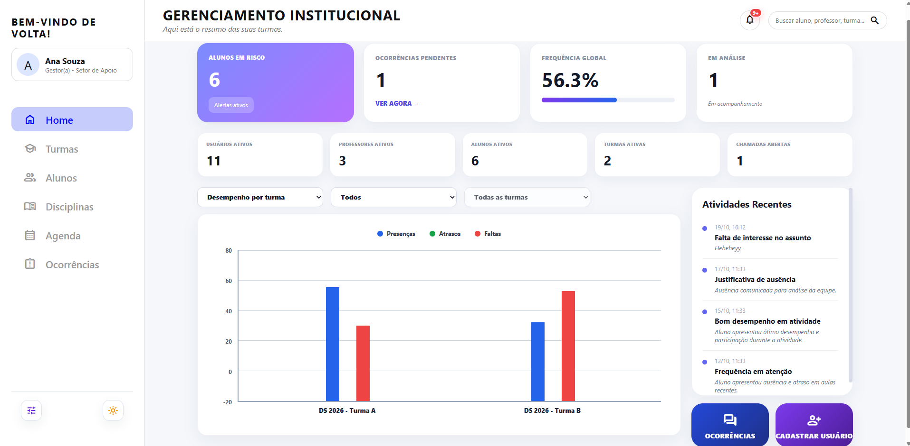

# PreZence | Controle Inteligente de Frequência Escolar

<p align="center">
  
</p>

<p align="center">
  <strong>A chamada do futuro é a Biometria.</strong><br>
  Sistema web full-stack para automação e registro de frequência escolar com reconhecimento facial, geofencing e análise por Inteligência Artificial.
</p>

<p align="center">
  
  
  
</p>

---

## Índice

- [Sobre o Projeto](#sobre-o-projeto)
- [Problema e Objetivo](#problema-e-objetivo)
- [Arquitetura do Sistema](#arquitetura-do-sistema)
- [Funcionalidades](#funcionalidades)
- [Diferenciais do PreZence](#diferenciais-do-prezence)
- [Privacidade e Tratamento de Dados (LGPD)](#privacidade-e-tratamento-de-dados-lgpd)
- [Fluxo de Operação](#fluxo-de-operacao)
- [Demonstração do Sistema](#demonstracao-do-sistema)
- [Tecnologias Utilizadas](#tecnologias-utilizadas)
- [Equipe de Desenvolvimento](#equipe-de-desenvolvimento)

---

## Sobre o Projeto

O **PreZence** é uma plataforma de gerenciamento de frequência escolar desenvolvida para modernizar o processo de registro de presença em instituições de ensino.

O sistema integra reconhecimento facial por meio do módulo **ByoID**, validação geográfica por **Geofencing** e análise automatizada de dados com a **Gemini API**, mantendo o docente responsável pela conferência e validação final dos registros.

A plataforma oferece ambientes específicos para alunos, professores e gestores, centralizando o acompanhamento de frequências, o gerenciamento de chamadas e a elaboração de relatórios.

Desenvolvido como Trabalho de Conclusão de Curso (TCC) técnico em Desenvolvimento de Sistemas pela equipe **ByID**.

---

## Problema e Objetivo

A realização de chamadas nominais tradicionais pode consumir parte significativa do tempo útil de aula, especialmente em turmas numerosas. Além disso, o processo está sujeito a inconsistências nos registros e dificuldades operacionais.

O PreZence surge como uma alternativa para digitalizar e otimizar esse procedimento, combinando automação, diferentes métodos de identificação e supervisão docente.

**Objetivos técnicos e funcionais:**

- **Automatizar o registro de presença:** integrar reconhecimento facial e validação geográfica, conforme o método de chamada utilizado.
- **Favorecer a continuidade operacional:** disponibilizar métodos alternativos, como tokens temporários e lançamento manual, para situações em que o reconhecimento facial não possa ser utilizado.
- **Centralizar o histórico de frequência:** organizar informações de alunos, turmas, chamadas e registros em uma base de dados relacional.
- **Controlar os níveis de acesso:** disponibilizar permissões e funcionalidades de acordo com os perfis de alunos, professores e gestores.
- **Apoiar a análise de frequência:** utilizar Inteligência Artificial para auxiliar na identificação de padrões de ausência e na elaboração de relatórios.

---

## Arquitetura do Sistema

O PreZence utiliza uma arquitetura cliente-servidor baseada em **API REST**, separando a interface do usuário, o processamento das regras de negócio e os serviços responsáveis pelas funcionalidades complementares.

```text
┌───────────────────────────────────────────────────────────────────┐
│                            FRONT-END                              │
│                      HTML · CSS · JavaScript                      │
│                                                                   │
│                Interface, câmera e geolocalização                 │
└─────────────────────────────────┬─────────────────────────────────┘
                                  │
                                  ▼
┌───────────────────────────────────────────────────────────────────┐
│                            BACK-END                               │
│                  Java · Spring Boot · API REST                    │
│                                                                   │
│                  Regras de negócio e processamento                │
└──────────────┬──────────────────┬──────────────────┬─────────────┘
               │                  │                  │
               ▼                  ▼                  ▼
┌────────────────────┐ ┌────────────────────┐ ┌────────────────────┐
│       ByoID        │ │     Gemini API     │ │       MySQL        │
│                    │ │                    │ │                    │
│ Reconhecimento     │ │ Relatórios e       │ │ Persistência de    │
│ facial             │ │ análise de dados   │ │ dados relacionais  │
└────────────────────┘ └────────────────────┘ └────────────────────┘
```

**Componentes da arquitetura:**

- **Front-End:** responsável pela apresentação das interfaces, interação com o usuário e recursos de captura de imagem e geolocalização.
- **Back-End:** desenvolvido em Java com Spring Boot, concentra as regras de negócio, processa as solicitações e realiza a comunicação com os serviços integrados.
- **ByoID:** módulo responsável pelo reconhecimento facial utilizado no processo de identificação.
- **Gemini API:** serviço de Inteligência Artificial integrado à elaboração de relatórios e à análise de informações de frequência.
- **MySQL:** banco de dados relacional utilizado para armazenar e organizar as informações da aplicação.

---

## Funcionalidades

### 1. Reconhecimento Facial — ByoID

Identificação de estudantes por meio da captura facial e comparação com os dados de referência cadastrados previamente no sistema.

O recurso oferece uma alternativa automatizada ao processo convencional de chamada, integrando a tecnologia autoral ByoID ao fluxo de registro de presença.

### 2. Validação Geográfica — Geofencing

Utilização de coordenadas geográficas (*latitude* e *longitude*) para verificar se a solicitação de presença está sendo realizada dentro do perímetro estabelecido pela instituição de ensino.

A validação geográfica atua como um mecanismo complementar de verificação, contribuindo para a confiabilidade dos registros.

### 3. Métodos Alternativos de Chamada

O PreZence disponibiliza diferentes possibilidades de registro, considerando situações em que o estudante não consegue utilizar o reconhecimento facial ou não dispõe de um dispositivo adequado.

- **Tokens temporários:** códigos gerados para permitir a solicitação alternativa de presença, com atualização periódica.
- **Lançamento manual:** possibilidade de o professor registrar ou corrigir individualmente a frequência dos estudantes.

### 4. Gerenciamento de Chamadas

Painel destinado aos professores para acompanhar as solicitações de presença, conferir os registros recebidos e realizar ajustes quando necessário.

O docente mantém a responsabilidade pela validação final, podendo revisar as informações antes de consolidar a chamada.

### 5. Relatórios Inteligentes — Gemini API

Integração com a Gemini API para auxiliar na elaboração de relatórios analíticos a partir dos dados de frequência e das justificativas apresentadas pelos estudantes.

A ferramenta auxilia na identificação de padrões de ausência e na organização das informações, gerando um conteúdo prévio que pode ser revisado, editado e regenerado pelo professor.

### 6. Ambientes de Acesso

A plataforma possui interfaces específicas para diferentes perfis de utilização:

| Perfil | Funcionalidades |
|:---|:---|
| **Aluno** | Participação nas chamadas, consulta de faltas e avisos. |
| **Professor** | Gerenciamento de chamadas, acompanhamento de turmas e elaboração de relatórios. |
| **Gestor** | Gerenciamento de usuários, turmas, frequências e informações administrativas. |

---

## Diferenciais do PreZence

O principal diferencial do PreZence está na combinação de tecnologias e mecanismos de validação para modernizar o controle de frequência escolar.

- **Identificação automatizada:** utilização de reconhecimento facial para facilitar o registro de presença.
- **Validação contextual:** integração com geolocalização para verificar a localização do estudante no momento da solicitação.
- **Flexibilidade operacional:** disponibilização de métodos alternativos de registro para diferentes situações.
- **Supervisão docente:** manutenção do professor como responsável pela conferência e consolidação das chamadas.
- **Análise assistida por IA:** geração de relatórios que auxiliam o acompanhamento da frequência escolar.

---

## Privacidade e Tratamento de Dados (LGPD)

Considerando a natureza das informações tratadas pelo PreZence, especialmente os dados biométricos, o projeto considera os princípios de proteção de dados estabelecidos pela **Lei Geral de Proteção de Dados Pessoais (LGPD — Lei nº 13.709/2018)**.

O tratamento das informações deve observar critérios de finalidade, necessidade, segurança, transparência e controle de acesso.

**Aspectos considerados no projeto:**

- **Dados pessoais:** informações cadastrais e acadêmicas necessárias à identificação dos estudantes e à organização das turmas.
- **Dados biométricos:** informações utilizadas pelo módulo ByoID no processo de reconhecimento facial. Por serem dados pessoais sensíveis, exigem cuidados específicos de tratamento e proteção.
- **Geolocalização:** utilização das coordenadas geográficas para a validação de localização durante a solicitação de presença, conforme o fluxo de utilização.
- **Controle de acesso:** separação das funcionalidades e informações disponíveis de acordo com os perfis de alunos, professores e gestores.
- **Integrações externas:** utilização de serviços de terceiros, como a Gemini API, que exige atenção aos dados compartilhados e às respectivas políticas de tratamento.

A implementação das medidas de proteção, os períodos de retenção e o armazenamento das informações biométricas devem corresponder ao funcionamento efetivo do sistema e às configurações adotadas no ambiente de execução.

> A inclusão desta seção demonstra a preocupação do projeto com a privacidade e a proteção de dados pessoais, sem representar, isoladamente, uma declaração de conformidade integral com a LGPD.

---

## Fluxo de Operação

O processo de registro de frequência combina identificação, verificações técnicas e supervisão docente.

**Etapas do processo:**

1. **Solicitação de presença:** o estudante inicia o registro por meio do reconhecimento facial ou de um método alternativo disponível, como token.
2. **Validação técnica:** o sistema realiza as verificações aplicáveis ao método selecionado, considerando as regras da chamada, a identificação e a localização quando exigidas.
3. **Encaminhamento da solicitação:** o registro fica disponível para acompanhamento do professor responsável pela turma.
4. **Conferência docente:** o professor verifica as solicitações, realiza eventuais correções e valida as informações.
5. **Consolidação da chamada:** após a finalização pelo docente, os registros de frequência são armazenados no banco de dados.

<p align="center">
  
</p>

---

## Demonstração do Sistema

Conheça as principais interfaces do PreZence e os diferentes ambientes disponibilizados pela plataforma.

### Tela Inicial

<p align="center">
  
</p>

### Área do Aluno

<p align="center">
  
</p>

### Área do Professor

<p align="center">
  
</p>

### Área do Gestor

<p align="center">
  
</p>

---

## Tecnologias Utilizadas

A estrutura tecnológica do PreZence reúne ferramentas utilizadas no desenvolvimento da aplicação, no armazenamento de informações e na integração de serviços externos.

| Camada / Domínio | Tecnologia | Aplicação |
|:---|:---|:---|
| **Back-End** | Java + Spring Boot | API REST e regras de negócio |
| **Banco de Dados** | MySQL | Persistência de dados relacionais |
| **Front-End** | HTML5, CSS3 e JavaScript | Interfaces e interatividade |
| **Biometria** | ByoID | Reconhecimento facial |
| **Inteligência Artificial** | Gemini API | Análise de frequência e relatórios assistidos |

---

## Equipe de Desenvolvimento

Projeto desenvolvido pela equipe **ByID**, formada por estudantes do curso técnico em Desenvolvimento de Sistemas.

| Integrante | Atuação Principal | Foco Técnico |
|:---|:---|:---|
| **Lexander Bonfim** | Liderança Técnica e Front-End | Gestão do escopo, arquitetura de interface e integração |
| **Adrielly da Silva** | Análise de Sistemas e UI/UX | Levantamento de requisitos, prototipação e Front-End |
| **Jhon Santos** | Desenvolvimento Full-Stack | Implementação de funcionalidades Back-End e interfaces Web |
| **Kevyn Leal** | Arquitetura e Back-End | Modelagem de banco de dados, APIs e integrações externas |

---

<p align="center">
  
</p>

<h2 align="center">PreZence</h2>

<p align="center">
  <strong>A chamada do futuro é a Biometria.</strong><br>
  Transformando a maneira de acompanhar a frequência escolar.
</p>

<p align="center">
  Desenvolvido pela equipe ByID · 2026
</p>
